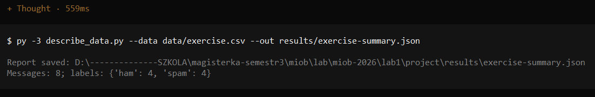
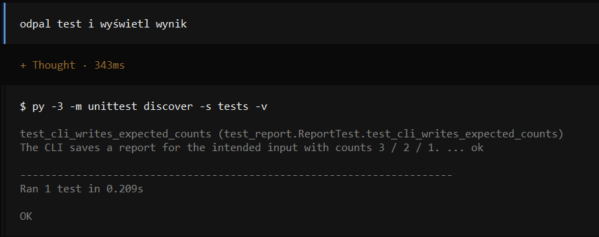
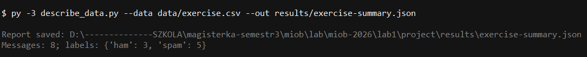

**opencode · DeepSeek V4.1 Flash Free · Low**

## Etap 1 — pierwsze uruchomienie i test

### 1. Rozpoznaj projekt
Lab1 jest projektem, który przeprowadza klasyfikację wiadomości mailowych na podstawie zbioru Apache SpamAssassin. Klasyfikacja dotyczy tego, czy dana wiadomośc mailowa to spam.

Skrypt describe_data.py czyta pliki CSV z folderu `data/`, przeprowadza klasyfikację a następnie zapisuje wyniki do folderu `results/` w formacie JSON. Wyniki składają się m.in. z liczby wiadomości ogółem, liczby wiadomości spam oraz liczby wiadomości "ham" czyli normalnych.

Aby odpalić projekt wymagany jest Python w wersji min. 3.1. Następnie należy wykonać w zależności od celu:

1. Uruchomienie na danych ćwiczeniowych

    `py -3 describe_data.py --data data/exercise.csv --out results/exercise-summary.json`

    Raport zostanie zapisany w results/exercise-summary.json (katalog tworzy się sam, a stary raport jest nadpisywany).
2. Wersja demonstracyjna prowadzącego

    `py -3 describe_data.py --data data/demo.csv --out results/demo-summary.json`
3. Test działający na trzech syntetycznych wiadomościach (2 ham, 1 spam), raport tworzy w katalogu tymczasowym i go usuwa

    `py -3 -m unittest discover -s tests -v`

### 3. Zleć wykonanie i odczyt raportu oraz odbierz wynik

Analiza została poprawnie wykonana. Wskazuje na to data modyfikacji pliku raportu która wskazuje na chwilę po wykonaniu polecenia przez agenta. Dodatkowo wskazuje na to fragment konwersacji:

Agent wywołuje polecenia w swojej sesji terminala i obserwuje ich wynik.

Istnieje jednak problem zw. z rozbieżnością sha256 pliku `exercise.csv` oraz deklaracją tego sha256 w pliku `data/manifest.json`. Oznacza to że plik został zmodyfikowany trakcie przygotowania danych. Analiza uwzględniała wszystkie 8 wiadomości, jednak wg. `manifest.json` niepoprawnie przypisała etykiety. Powinno być 5 ham i 3 spam a jest 4 ham i 4 spam. Po sprawdzeniu pliku `exercise.csv` okazało się że exercise-001 ma etykietę spam, a powinno mieć "ham" zgodnie z `manifest.json`. "input_file" zgadza się z tym co zostało podane w poleceniu.

### 5. Odczytaj wynik gotowego testu

Test został wykonany i zakończył się sukcesem. Dowodem na to jest fragment konwersacji:

Test uruchamia jako podproces pełnoprawny raport, jednak z przykładowymi wiadomościami umieszczonymi w `tests/fixtures/messages.csv`. Następnie zapisuje plik do katalogu tymczasowego a po zakończeniu testu ten katalog jest usuwany (służy to tego blok `with`). Następnie weryfikuje czy analiza zakończyła się sukcesem, czy raport jest poprawnym JSONem oraz czy dotyczy odpowiedniego pliku wejściowego a następnie sprawdza czy etykiety są zgodne z oczekiwaniami.

## Etap 2 — dane się zmieniły

Dane zostały poprawnie zmienione za pomocą agenta. Zgodnie z konwersacją aktualny raport ma stosunek ham do spam 4:4, natomiast dane wskazują na stosunek 3:5. Liczba wszystkich wiadomości nie zmieni się. Aby ponownie uzyskać aktualny raport trzeba jeszcze raz odpalić analizę.

Ponowna analiza została wykonana:

Przewidywane wyniki są zgodne z aktualnymi. Cel laboratorium został osiągnięty.