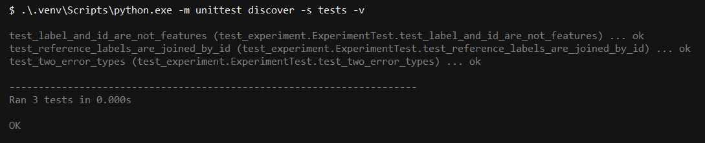
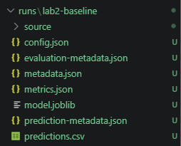
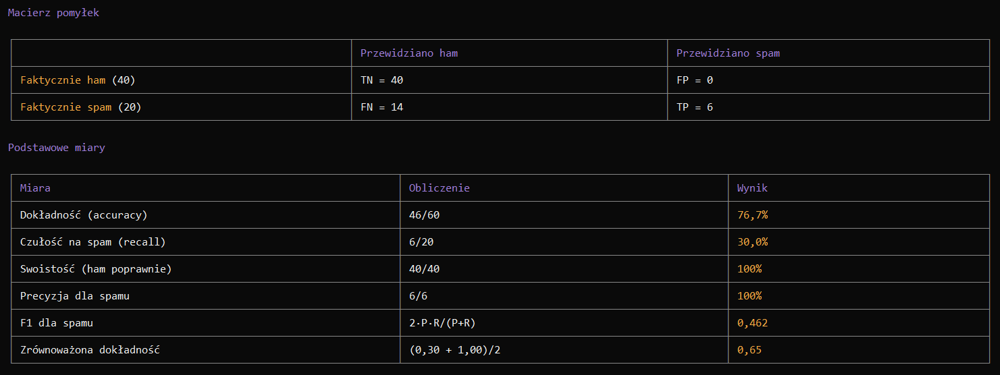
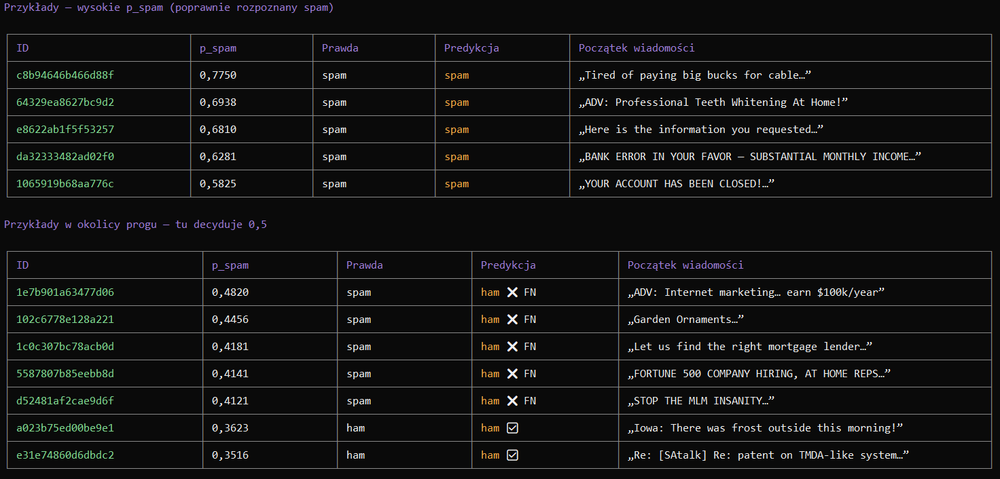

**opencode · DeepSeek V4.1 Flash Free · Low**

# 1. Uzgodniony plan oraz Twoje uzasadnienie przyjęcia lub korekty, zapisane przed eksperymentem.

Cel laboratorium: zbudować model klasyfikujący emaile do klas ham oraz spam.

Ponieważ założeniem projektu jest brak ingerencji w kod oraz dane, nie pozostaje nic innego jak po prostu wytrenować model i go sprawdzić na zbiorze testowym

Uzgodniony plan:

1. Potwierdzenie integralności danych i przygotowanie środowiska

Sprawdzić, że dane są oryginalne (zgodne z manifestem/hashami), że dostępne są podziały train i validation, oraz przygotować środowisko. Na końcu uruchomić testy jednostkowe kodu.

2. Trening modelu na zbiorze treningowym

Wytrenować model (skalowanie + regresja logistyczna z ustalonym C, sześć cech liczbowych) na wierszach z podziału train. Zapisanie modelu i konfiguracji w nowym, unikalnym katalogu przebiegu.

3. Predykcja na zbiorze walidacyjnym

Użyć zapisanego modelu do wygenerowania oszacowań prawdopodobieństwa i etykiet dla wszystkich 60 maili z validation. Zapisanie predykcji wraz z ich metadanymi (który model, jaki zbiór, jaki hash danych i pliku predykcji).

4. Ocena predykcji przez porównanie z etykietami walidacji

Połączyć zapisane predykcje z etykietami referencyjnymi po identyfikatorze wiadomości i policzyć liczbę trafień oraz pomyłek w czterech kategoriach: TP, TN, FP, FN, a także łączną liczbę błędów.

5. Interpretacja i opis wyniku

Odczytać liczbę błędów na 60 wiadomościach, wskazać konkretne pomyłki (identyfikator, oszacowane prawdopodobieństwo, prawdziwa etykieta) i opisać je w kontekście ograniczeń danych i modelu.

# 2. Katalog wyników, wykonane polecenia i wyniki sprawdzeń. Pokaż w sesji konfigurację, istotne pola metadanych opisane w części „Wyjaśnij wynik” i metryki; wskaż ewentualne odstępstwo od planu i jego powód.

### Przygotowanie środowiska

Środowisko zostało poprawnie przygotowane. Agent utworzył wirtualne środowisko oraz odpalił testy jednostkowe oraz zweryfikował integralność danych.

### Trening modelu

Trening modelu, predykcja oraz walidacja przebiegły poprawnie. Wskazuje na to utworzony katalog runs/lab2-baseline:

Model został wytrenowany na danych treningowych. Wskazuje na to właściwość `"training_data": "train"` w pliku metadata.json.

# 3. Liczba ocenionych wiadomości, FP, FN i suma pomyłek oraz omówione przykłady decyzji: ID, etykieta, przewidywanie, znaczenie.

Model ocenił 60 wiadomości (`"n": 60,` z pliku metrics.json). Poniżej zaprezentowano wyniki oceny modelu:

Oraz przykładowe wiadomości z ich klasyfikacją:

Wyniki ewaluacji wskazują na to, że klasyfikacja odbywa się bardzo zachowawczo. Wskazuje na to niski współczynnik recall oraz wysoka precyzja dla spamu. Model jest lepszy jedynie o ok. 10% od założenia, że "wszystkie wiadomości to ham", ponieważ taki model na zbiorze testowym otrzymałby accuracy na poziomie ok. 66%.

# 4. Jedno zdanie: na jakie pytanie odpowiada wynik i czego nie potwierdza.
Wynik odpowiada na pytanie: "Jak dobrą predykcję model przeprowadza na zbiorze walidacyjnym?", jednak nie potwierdza skuteczności tego modelu w rzeczywistości.
