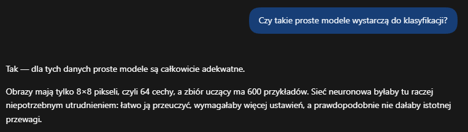
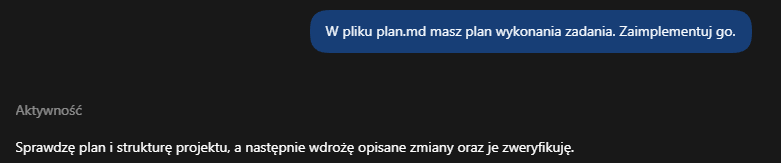
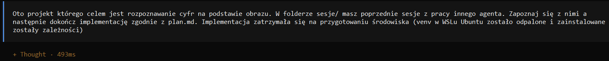
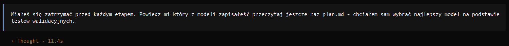
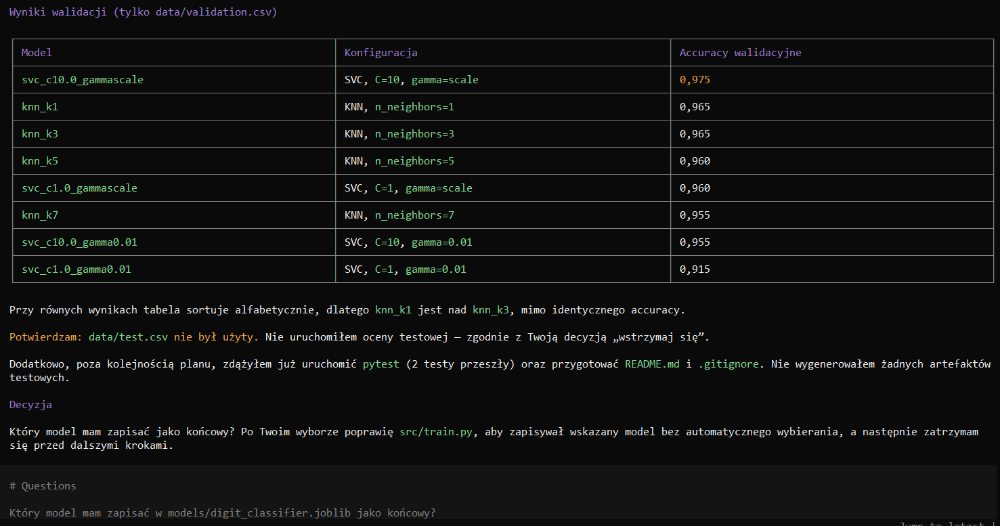
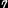
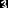

**codex · GPT 5.6 Terra · Lekki** oraz **opencode · DeepSeek V4.1 Flash Free · Low**
# Wybrane podejście, najważniejsze decyzje i ich uzasadnienie. Wskaż, co przemówiło za tym rozwiązaniem względem jednej rozważanej alternatywy.
Wybranym podejściem jest porównanie modeli KNN oraz SVC (modyfikacja SVM) i wybranie lepszego z nich. Początkowo zamysł był taki aby wykorzystać sieci neuronowe, jednak agent podczas sesji analizy przekonał mnie, że obrazy są na tyle małe, że byłoby to niepotrzebne utrudnienie. Poniżej zrzut ekranu z sesji:

# Organizację współpracy z agentem. Przytocz jedno zlecenie faktycznie przekazane agentowi i uzasadnij jego zakres. Pokaż jeden moment, w którym wynik sprawdzenia wpłynął na dalsze działanie agenta lub Twoją decyzję.

Współpraca z agentem polegała na jednej sesji analizy, gdzie przygotowano plik plan.md, który był wejściem dla innego agenta, który miał za zadanie przejść przez niego krok po kroku. Skoro przygotowany został szczegółowy plik plan.md, nie pozostało nic innego jak zaimplementować go:

Niestety w tym agencie skończyły się tokeny tuż po instalacji zależności w venv, dlatego dalszą pracę wykonano na **opencode · DeepSeek V4.1 Flash Free · Low** [zapis sesji](sesje/wykonanie-2.md). Poniżej treść polecenia, którą trzeba było skorygować aby agent trzymał się planu:

Poniżej korekta poprzedniego polecenia:

Potem agent wykonywał plan krok po kroku, czego efektem jest human review na podstawie wyników ewaluacji poszczególnych modeli:

Ponieważ model SVC osiągnął najlepsze wyniki, został wybrany do dalszej pracy.

# Wyniki oceny i omówienie pomyłek. Powiąż wnioski z konkretnymi plikami oraz obserwacjami.

Ocena zapisanego modelu `svc_c10.0_gammascale` na `data/test.csv` jest opisana w `artifacts/test_metrics.json` i `artifacts/test_metrics.md`: **198/200 trafień, accuracy 0,99, 2 pomyłki**. Macierz pomyłek (`artifacts/confusion_matrix.png`, tabele w `test_metrics.md`) ma 20 trafień w każdym wierszu, a jedyne wartości poza przekątną to `3 → 2` i `7 → 9`. Pełna lista 200 predykcji z `image_id`, ścieżką, etykietą i flagą `correct` znajduje się w `artifacts/test_predictions.csv`, a oba błędne przypadki są pokazane na `artifacts/misclassified_examples.png`.

### Pomyłki:

Model pomylił się jedynie przy ocenie dwóch plików:

- `data/images/digit-09e2a05d6bd2.png`:
, gdzie znak "7" rozpoznał jako "9"

- `data/images/digit-4c5c0534e4b8.png`:
, gdzie znak "3" rozpoznał jako "2"

# Ocenę, czy rezultat można przyjąć jako prototyp w ustalonym zakresie. Wskaż istotne ograniczenia, niewykonane sprawdzenia i ewentualną pozostałą pracę.

Przygotwany projekt oraz model spełnia wszystkie oczekiwania zadania, dlatego może zostać przyjęty jako prototyp w ustalonym zakresie. Szczególnie dlatego, że dokładność modelu jest na poziomie 99%. Główne ograniczenia to mała próba 200 obrazów oraz tylko 20 testowych przykładów na klasę. Niewykonane sprawdzenia: brak prawdopodobieństw/marginesów decyzji w src/evaluate.py, brak metryk per klasa (precision/recall/F1), brak powtórzeń na innych podziałach i brak testu na znakach spoza dostarczonego zbioru. 

Pozostała praca: dodać ocenę niepewności i per-klasową, sprawdzić odporność na zaszumienie/przesunięcie oraz — jeśli prototyp ma wyjść poza przygotowane obrazy — rozważyć segmentację i normalizację wejścia.